

<picture>
<source media="(max-width: 640px)" srcset="https://raw.githubusercontent.com/Fredler21/Fredler21/main/assets/hero-mobile.svg">
</picture>

&nbsp;
<a href="https://linkedin.com/in/fredlergraciapierre-louis">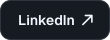</a>

<picture>
<source media="(max-width: 640px)" srcset="https://raw.githubusercontent.com/Fredler21/Fredler21/main/assets/numbers-mobile.svg">
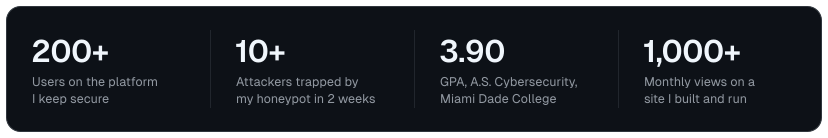
</picture>

## Hi, I'm Fredler

I'm a cybersecurity student at Miami Dade College (GPA 3.90) and the Technology & Cybersecurity Lead at [EdLight Initiative](https://code.edlight.org), where I keep the backend for 200+ users running and locked down.

I learn security by building real things and then defending them. I write the Firebase rules, I run the Nmap and Nikto scans, and I report what I find with a fix. I built my own honeypot because I wanted to watch real attackers instead of only reading about them. It caught more than 10 of them in its first two weeks.

**I'm looking for a security internship or a junior security role.** Miami, FL.

## Selected work

Click any card to open the project.

<a href="https://bulletproofsentinel.com">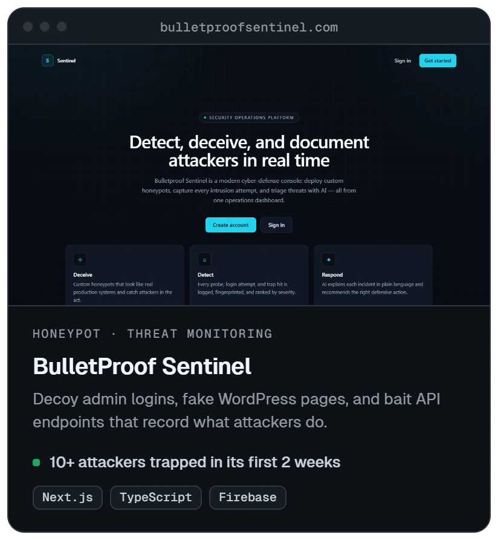</a>
<a href="https://github.com/Fredler21/FreddySec">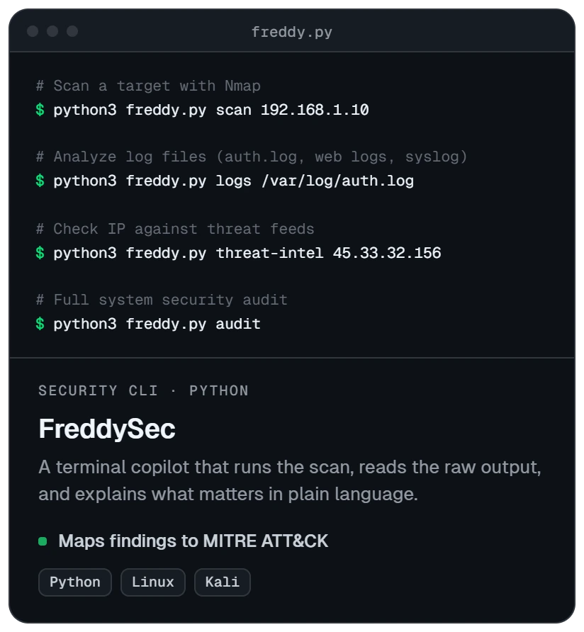</a>
<a href="https://edight-security-training.vercel.app">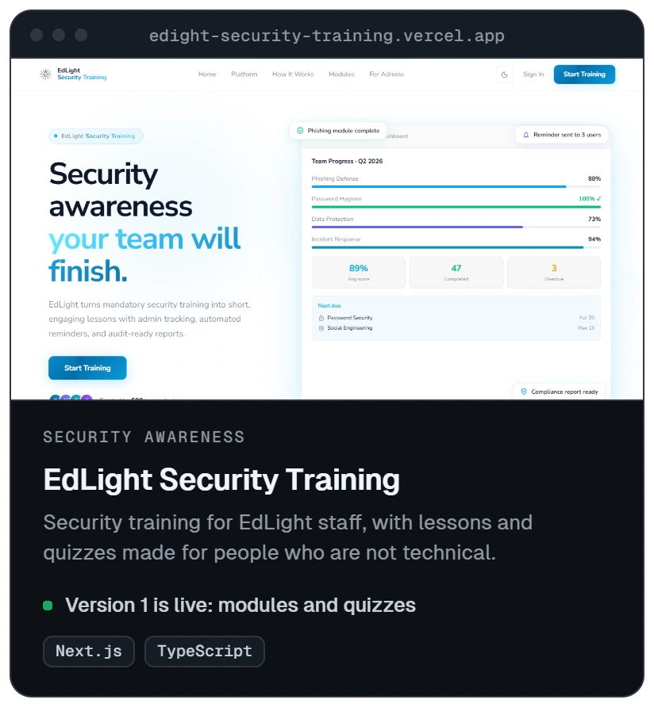</a>
<a href="https://trycleaninghacks.com">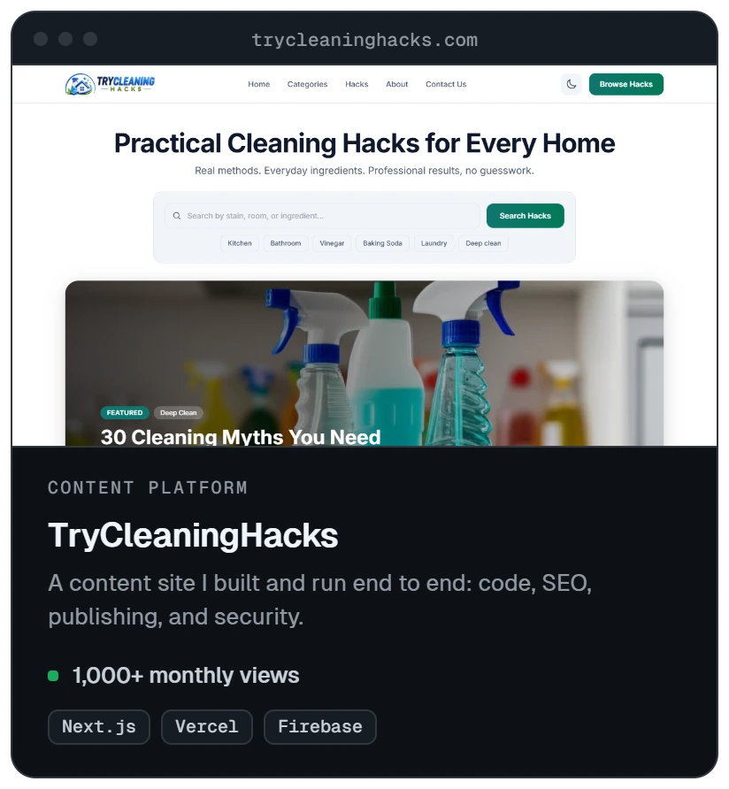</a>
<a href="https://prezidan-pa-m.web.app">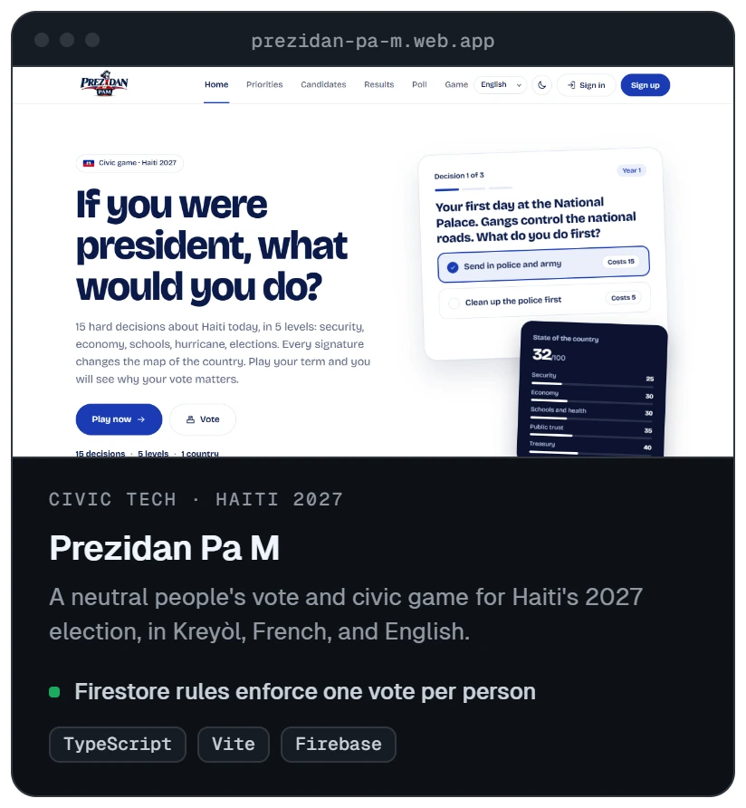</a>
<a href="https://fredler21.github.io/devicepeek/">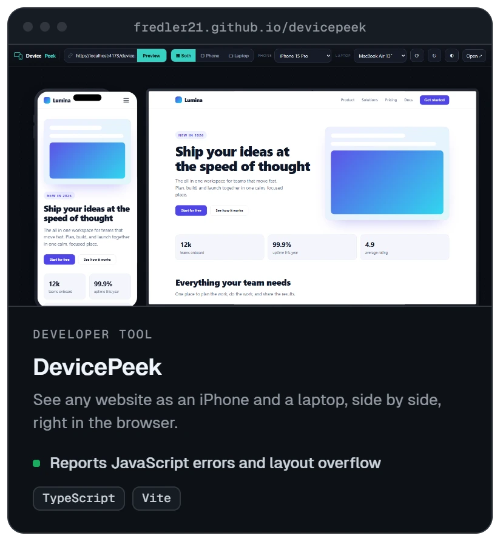</a>

**Source code:** [BulletProof Sentinel](https://github.com/Fredler21/BulletProof-Sentinel) · [FreddySec](https://github.com/Fredler21/FreddySec) · [Security Training](https://github.com/Fredler21/Security-Training) · [TryCleaningHacks](https://github.com/Fredler21/New-Cleaning-Apps-) · [Prezidan Pa M](https://github.com/Fredler21/prezidan-pa-m) · [DevicePeek](https://github.com/Fredler21/devicepeek) · [EdLight Backend System](https://github.com/Fredler21/Backend_System)

## What I'm working on now

- Building [Prezidan Pa M](https://prezidan-pa-m.web.app) ahead of Haiti's 2027 election
- Studying incident handling and response (EC-Council ECIH v3 coursework) for my B.S. in Cybersecurity
- Taking EdLight Security Training from version 1 to real logins and progress tracking

## Experience

**Technology & Cybersecurity Lead · EdLight Initiative** · 08/2023 to present

- Manage and secure the backend systems behind [code.edlight.org](https://code.edlight.org), used by 200+ users
- Write and maintain the Firebase security rules that control who can read and write platform data
- Run Nmap port and service scans and Nikto web scans, test attack scenarios on our endpoints, and report what I find with a suggested fix
- Run the help desk for EdLight Scholars (300 Coursera and 300 DataCamp licenses): logins, account access, and license problems
- Lead student meetings and track their progress through the programs

## Toolkit

**Security**

<picture>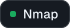</picture>
<picture>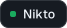</picture>
<picture>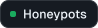</picture>
<picture>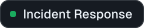</picture>
<picture>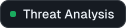</picture>
 
<picture>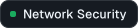</picture>
<picture>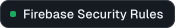</picture>

**Build**

<picture></picture>
<picture>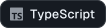</picture>
<picture></picture>
<picture>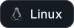</picture>
<picture>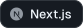</picture>
<picture>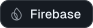</picture>
<picture>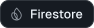</picture>
<picture>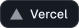</picture>

**Spoken languages:** English · French · Haitian Creole

## Education

- **B.S. Cybersecurity** · Miami Dade College · expected 05/2028
- **A.S. Cybersecurity** · Miami Dade College · 2024 to 2026 · GPA 3.90 / 4.0
- **CCC, Cybersecurity Analyst & Network Security** · Miami Dade College · 2024 to 2026 · GPA 3.90 / 4.0

**Honors and activities**

- Academic Excellence Award, 6 terms in a row
- Cybersentinels club · Blue Team at the MDC Mini-Hackathon (03/2025)
- Mastercard Security job simulation (10/2024): identified and reported phishing threats and designed security training for at-risk teams

## GitHub activity

<picture>
<source media="(max-width: 640px)" srcset="https://raw.githubusercontent.com/Fredler21/Fredler21/output/activity-mobile.svg">
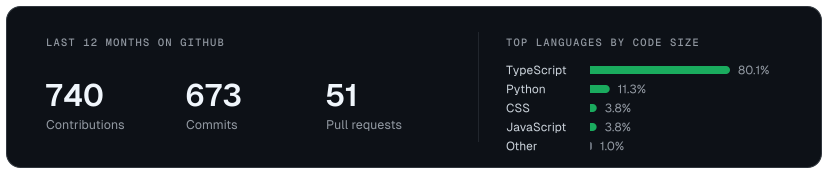
</picture>

<picture>
<source media="(prefers-color-scheme: dark)" srcset="https://raw.githubusercontent.com/Fredler21/Fredler21/output/github-snake-dark.svg">
<source media="(prefers-color-scheme: light)" srcset="https://raw.githubusercontent.com/Fredler21/Fredler21/output/github-snake.svg">

</picture>

## Get in touch

<a href="mailto:fredlerpierrelouis21@gmail.com"><picture>
<source media="(max-width: 640px)" srcset="https://raw.githubusercontent.com/Fredler21/Fredler21/main/assets/cta-mobile.svg">
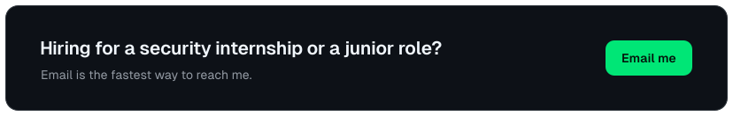
</picture></a>

<a href="mailto:fredlerpierrelouis21@gmail.com">fredlerpierrelouis21@gmail.com</a> · <a href="https://linkedin.com/in/fredlergraciapierre-louis">LinkedIn</a> · Miami, FL

The activity card and the contribution graph rebuild themselves every day with a GitHub Action in <a href="https://github.com/Fredler21/Fredler21/tree/main/.github">this repo</a>.

