  

## Hi, I'm Fredler

I'm a cybersecurity student at Miami Dade College (GPA 3.90) and the Technology & Cybersecurity Lead at [EdLight Initiative](https://code.edlight.org), where I keep the backend for 200+ students running and locked down.

I learn security by building real things and then defending them. I write the Firebase rules, I run the Nmap and Nikto scans, and I report what I find with a fix. I built my own honeypot because I wanted to watch real attackers instead of only reading about them. It caught more than 10 of them in its first two weeks.

**I'm looking for a security internship or a junior security role.** Miami, FL.

## What I've built

<table>
<tr>
<td width="50%" valign="top">

### [BulletProof Sentinel](https://github.com/Fredler21/BulletProof-Sentinel)

A honeypot and threat monitoring platform I designed from scratch. Decoy admin logins, fake WordPress pages, and bait API endpoints record what attackers do.

- Trapped **10+ attackers** in its first 2 weeks
- Blocks repeat offenders by IP, including VPN and proxy attempts
- Firestore rules keep access to authorized accounts only

  

[Live demo](https://bullet-proof-sentinel-ai.vercel.app) · [Code](https://github.com/Fredler21/BulletProof-Sentinel)

</td>
<td width="50%" valign="top">

### [FreddySec](https://github.com/Fredler21/FreddySec)

A security copilot for the terminal. It runs the scan, reads the raw output, and explains what matters in plain language.

- Works with Nmap, Nikto, OpenSSL, auth logs, and web server logs
- Maps findings to MITRE ATT&CK and pulls out indicators of compromise
- Ranks issues by severity and gives the commands to fix and verify

  

[Code](https://github.com/Fredler21/FreddySec)

</td>
</tr>
<tr>
<td width="50%" valign="top">

### [EdLight Security Training](https://github.com/Fredler21/Security-Training)

A security awareness training site for EdLight staff, with lessons and quizzes made for people who are not technical.

- Version 1 is live: training modules and the quiz system
- Next: Google login, progress tracking, and an admin dashboard

 

[Live site](https://edight-security-training.vercel.app) · [Code](https://github.com/Fredler21/Security-Training)

</td>
<td width="50%" valign="top">

### [TryCleaningHacks](https://trycleaninghacks.com)

A content site I built and run end to end: code, SEO, publishing, and security.

- Grew to **1,000+ monthly views** through SEO, sitemaps, and Pinterest
- I manage the domain, DNS, and HTTPS, watch the traffic for bots, and patch dependencies
- API keys are stored in environment variables to protect secrets

  

[Live site](https://trycleaninghacks.com) · [Code](https://github.com/Fredler21/New-Cleaning-Apps-)

</td>
</tr>
</table>

**More:** [Prezidan Pa M](https://github.com/Fredler21/prezidan-pa-m), a neutral people's vote site for Haiti's 2027 election in Kreyòl, French, and English, with Firestore rules that enforce one vote per person · [DevicePeek](https://github.com/Fredler21/devicepeek), preview any site as an iPhone and a laptop side by side · [EdLight Backend System](https://github.com/Fredler21/Backend_System), users, authentication, and APIs in TypeScript.

## What I'm working on now

- Building [Prezidan Pa M](https://prezidan-pa-m.web.app) ahead of Haiti's 2027 election
- Studying incident handling and response (EC-Council ECIH v3 coursework) for my B.S. in Cybersecurity
- Taking EdLight Security Training from version 1 to real logins and progress tracking

## Experience

**Technology & Cybersecurity Lead · EdLight Initiative** · 08/2023 to present

- Manage and secure the backend systems behind [code.edlight.org](https://code.edlight.org), used by 200+ students
- Write and maintain the Firebase security rules that control who can read and write platform data
- Run Nmap port and service scans and Nikto web scans, test attack scenarios on our endpoints, and report what I find with a suggested fix
- Run the help desk for EdLight Scholars (300 Coursera and 300 DataCamp licenses): logins, account access, and license problems
- Lead student meetings and track their progress through the programs

## Skills

**Security**

      

**Build**

       

**Spoken languages:** English · French · Haitian Creole

## Education

| Degree | School | When | GPA |
|---|---|---|---|
| **B.S. Cybersecurity** | Miami Dade College | Expected 05/2028 | In progress |
| **A.S. Cybersecurity** | Miami Dade College | 2024 to 2026 | 3.90 / 4.0 |
| **CCC, Cybersecurity Analyst & Network Security** | Miami Dade College | 2024 to 2026 | 3.90 / 4.0 |

- Academic Excellence Award, 6 terms in a row
- Cybersentinels club · Blue Team at the MDC Mini-Hackathon (03/2025)
- Mastercard Security job simulation (10/2024): identified and reported phishing threats and designed security training for at-risk teams

## GitHub activity

  

<picture>
<source media="(prefers-color-scheme: dark)" srcset="https://raw.githubusercontent.com/Fredler21/Fredler21/output/github-snake-dark.svg" />
<source media="(prefers-color-scheme: light)" srcset="https://raw.githubusercontent.com/Fredler21/Fredler21/output/github-snake.svg" />

</picture>

## Get in touch

If you are hiring for a security internship or a junior security role, I'd like to hear from you. Email is the fastest way to reach me.

Miami, FL
